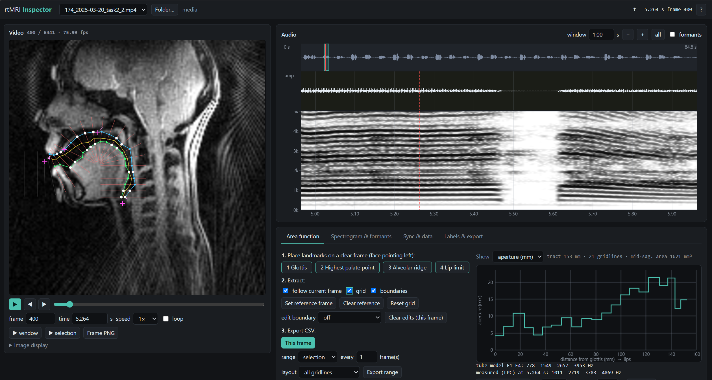

# rtMRI Inspect Python

A browser-based Python tool for inspecting **real-time MRI speech recordings** together with their audio. It shows synchronised video and audio, a spectrogram, formant tracks, and vocal-tract **area functions** extracted frame by frame, and exports the results as CSV.

It is a Python re-implementation of the MATLAB GUI [`inspect_rtmri`](https://mproctor.net/tools.html) (see [Credits](#credits)), rebuilt to run without MATLAB on current rtMRI data (tested on 146 × 146 px MP4 + WAV recordings at about 20 and 76 fps).

Everything runs **locally**. The app starts a small web server on your own machine and opens it in your browser; no data leaves the computer.

> **Research software.** The outputs (formants, areas, lengths) depend on settings and assumptions listed under [Constants and assumptions](#constants-and-assumptions). Check them against your own acquisition and review the overlays before using numbers in a publication.



---

## Features

- Synchronised **video + audio** on a single timeline, with overview waveform, zoomable waveform and spectrogram, and playback of a window or a selection.
- **Spectrogram** with adjustable window, step, frequency range, dynamic range and colour map; cursor readout of time **and frequency (Hz)**.
- **Formant tracking** (LPC with Viterbi continuity and a silence gate) overlaid on the spectrogram.
- **Area function** from the midsagittal image: semi-polar grid from four landmarks, airway centre-line, tissue boundaries, aperture (mm) and area (cm²) per gridline. Reference palate/pharynx, optional head-motion tracking, and manual boundary editing.
- **Tube model**: resonances of the extracted area function, and a **synthesised vowel** (Rosenberg glottal pulses through the tube) you can play or save.
- **Export**: area function for one frame or a range (CSV), formants (CSV), labels (CSV), spectrogram (PNG), frame (PNG), audio clip (WAV), video + audio clip (MP4).
- Sessions (landmarks, settings, edits, labels) are saved automatically per recording.

See **[GUIDE.md](GUIDE.md)** for a step-by-step walkthrough.

---

## Install

Requires Python 3.9+.

```bash
pip install -r requirements.txt     # numpy, scipy, opencv-python-headless, flask
```

`ffmpeg` is optional. If it is on your `PATH`, MP4 clip export (with audio) and audio extraction from video files are enabled.

## Run

```bash
python -m rtmri_web /path/to/data                 # scan a folder (recursively) for videos
python -m rtmri_web clip.mp4 --wav clip.wav       # open one video with a specific audio file
```

| Option | Meaning |
|---|---|
| `--out DIR` | Where sessions, clips and exports are written (default `./rtmri_output`) |
| `--port N` | Port for the local server (default `8765`) |
| `--no-browser` | Do not open a browser tab automatically |

Videos (`.mp4 .avi .mov .mkv .m4v .webm`) are paired with audio (`.wav .flac .mp3 .m4a .ogg`) by **identical base name**, looked up next to the video, in `wav/` or `audio/` folders beside or above it, then anywhere under the scanned folder. With no audio file, audio inside the video is used if present; otherwise the recording opens video-only.

---

## Constants and assumptions

All of these can be changed in the app unless noted. Defaults are what you get on a fresh recording.

### Image geometry

| Constant | Default | Notes |
|---|---|---|
| Field-of-view width | **280 mm** | *Sync & data* tab. Assumed to span the full image width. **Confirm for your acquisition.** |
| Pixel size | **FOV ÷ image width** (280 / 146 = **1.918 mm/px**) | Override with "pixel size (mm/px)". Scales every length and area. |
| Face direction | **Left** | The grid assumes the face points left. Tick "face points right" to mirror the image. |

> The original MATLAB tool used 280/288 = 0.972 mm/px for 146-px frames, which gives a tract about half the expected length (≈ 90 mm instead of ≈ 175 mm for an adult). This tool uses FOV ÷ width. If your images were cropped from a larger reconstruction matrix, set the correct pixel size yourself.

### Area function

| Constant | Default | Notes |
|---|---|---|
| Area law | **A (cm²) = α · d(cm)^β** | d is the midsagittal aperture along the gridline |
| α | **1.5** | **Generic placeholder.** Replace with the values from your chosen reference (e.g. region-specific coefficients from the literature). |
| β | **1.4** | **Generic placeholder.** As above. |
| Gridline length | **60 × W/340 px** (25.8 px at W = 146) | Scaled from the MATLAB display size (340 px) |
| Gridline spacing | **8 × W/340 px** (3.44 px at W = 146) | ≈ 27–30 gridlines. 2–2.5 px (≈ 35–40 lines) is the practical limit; below ≈ 1.7 px the centre-line becomes noisy and tract length is over-estimated |
| Boundary threshold | **0.55** | Fraction of the way from airway intensity to tissue intensity |
| Centre-line intensity weight | **0.15** | Weight of pixel darkness vs. path length (distances in 340-px display units, as in MATLAB) |
| Image smoothing | **σ = 0.8 px** | Applied after per-frame percentile contrast normalisation (1–99.5 %) |
| Tongue DCT smoothing | off; keeps **99 %** of energy when on | |
| Head-motion tracking | off; phase correlation, max shift **6 px** | Registers each frame to the reference frame |
| Lip limit | last gridline whose 90th-percentile intensity exceeds background + 0.45 × (tissue − background) | |
| Section length | gridline-to-gridline distance along the centre-line | Total = tract length (mm) |
| Midsagittal area | Σ aperture × section length (mm²) | Same quantity as MATLAB's `VTA` |

### Tube model and synthesis

| Constant | Value | Notes |
|---|---|---|
| Speed of sound | **35 000 cm/s** | |
| Resonances | zeros of the chain-matrix **D** element | Lossless tubes, **closed glottis**, **open lips (P = 0)**. No excitation is involved: these are resonance frequencies only. |
| Minimum area | 0.02 cm² (resonances), 0.05 cm² (synthesis) | Avoids singular sections at closures |
| Wall/propagation loss (synthesis) | α = 3.5 × 10⁻⁴ · √f per cm | Simple loss term to keep peaks finite |
| Lip radiation (synthesis) | Piston load, then first difference | |
| Glottal source | **Rosenberg pulse**: open phase 40 %, closing phase 16 % of period | |
| f0 | **120 Hz**, gliding to 85 % (102 Hz) over the sound | Editable (start value) |
| Duration / rate | **2 s**, 16 kHz, 30 ms fades | Duration editable (0.5–10 s) |

### Audio, spectrogram and formants

| Constant | Default | Notes |
|---|---|---|
| Scanner burst attenuation | first **0.55 s** × **0.1** | As in the MATLAB tool; affects display and analysis, **not playback** |
| Spectrogram window / step | **20 ms / 5 ms**, Hann | |
| Spectrogram max frequency | **5000 Hz** | |
| Dynamic range | **55 dB** below the file's 99.9th-percentile level | "Level shift" moves the top |
| Pre-emphasis | on (coefficient 0.97) | |
| Formants tracked | **4** | |
| Formant ceiling | **5500 Hz** | Audio is resampled so Nyquist ≈ 2 × ceiling |
| Formant window / step | **25 ms / 5 ms**, Hamming | |
| LPC order | **2 × formants + 2** (auto) | |
| Maximum bandwidth | **600 Hz** | Poles with wider bandwidth are discarded |
| Silence gate | **−40 dB** relative to the file's 95th-percentile frame level | Frames below are not tracked |
| Speaker scale | **1.0** | Scales the nominal formant targets (500, 1500, 2500, 3500, 4500 Hz); about 1.15 for female or child voices |
| Candidates per frame | 7 sharpest poles | Viterbi picks the best continuous set |

### Synchronisation

| Constant | Default | Notes |
|---|---|---|
| A/V offset | **0 s** | Positive delays the audio relative to the video. Both start at t = 0. |
| Frame lookup | per-frame container timestamps | Falls back to a uniform grid from the average fps |
| Offset estimate | motion energy vs. audio envelope, ±4 s | A **hint only**; see [Limitations](#limitations) |

---

## How it differs from the MATLAB tool

- Time-to-frame lookup uses real per-frame timestamps, not `floor(t · fps)`. Audio and video of different lengths are reported and can be offset explicitly.
- Pixel size is FOV ÷ width (see above).
- Frames are contrast-normalised and sampled with sub-pixel interpolation. The centre-line is a global minimum-cost path through all gridlines, and boundaries are found by threshold crossing with interpolation.
- Formants use LPC with a Viterbi continuity search and a silence gate (MATLAB: greedy per frame).
- Coil-shading correction is data-driven (blurred mean image), not coil-position based.
- Optional head-motion tracking; manual boundary editing is saved per frame.
- **Not ported:** CorAnal, tongue/segment comparison plots, tracked-AVI mode.

## Limitations

- Built and checked on 146 × 146 px midsagittal data from one scanner setup (about 20 and 76 fps). Landmarks must be re-placed for each recording because head position varies.
- The grid assumes a left-facing midsagittal slice with a visible hard palate and pharyngeal wall.
- The **A/V offset estimate** is weak: correlations are low and repetitive tasks create near-equal peaks at other lags. Judge alignment by eye.
- LPC formants are unreliable at high f0, in noise and during nasalisation; always compare with the spectrogram. The tube-model resonances come from a midsagittal-only, lossless model and will not match measured formants exactly.
- The area-function constants (α, β) are placeholders, not recommendations.
- Very fine gridline spacing inflates tract length (see the constants table).

## Troubleshooting

| Symptom | Likely cause / fix |
|---|---|
| Video opens but not paired with audio | Base names differ. Rename one file or use `--wav` |
| "Audio is N s longer/shorter than the video" | Informational. Check alignment, use the A/V offset if needed |
| Grid sits off the airway | Landmarks were placed on another recording or frame; use *Reset grid* and place them again |
| Lengths about half or double what you expect | Check FOV width / pixel size in *Sync & data* |
| Grid does not build | Glottis must be clearly right of the highest palate point; tick "face points right" if the face points right |
| No MP4 clip export | Install `ffmpeg`; WAV and PNG export work without it |
| Port in use | Start with `--port 8800` (or any free port) |

---

## Credits

This tool re-implements, in Python, the method of the MATLAB program **INSPECT_rtMRI** (`inspect_rtmri`, "Review dMRI frames"), written by:

- **Michael Proctor**
- **Adam Lammert**
- **Asterios Toutios**

Original tool: <https://mproctor.net/tools.html>. The MATLAB tool in turn builds on:

- the Ohman-style semi-polar analysis grid and tissue-boundary / area-function method of the original program;
- formant tracking code originally by Esfandiar Zavarehei (2003), modified by Michael Proctor (2008);
- intensity-correction code by Adam Lammert (2010), modified by Michael Proctor;
- third-party MATLAB utilities `dijkstra` (D. F. Gleich), `extrema` (C. A. V. Aguilera) and `freezeColors` (J. Iversen).

No MATLAB source code is copied here; the grid construction, centre-line, boundary-threshold and area-function steps follow the published structure of the original, re-written for Python. The original header also refers to the acquisition protocols of Narayanan et al. (2004) and Kennerley et al. (2022); please cite the original tool and those sources as appropriate for your work.

If you use this software, please also cite this repository.

## Licence

See the `LICENSE` file in this repository.
